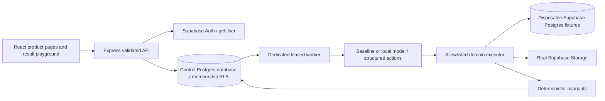

# Breakroom architecture

One website contains six independently usable verification products, implemented sequentially in `products/`. Shared infrastructure owns accounts, workspace/project navigation, durable execution, evidence and exact approvals.

## Boundaries

The local Supabase CLI runs Auth, PostgREST, Storage and Supabase Postgres in an isolated Colima VM. The active Docker context is unchanged. Workbench data lives in `breakroom_control`; disposable targets live in the Supabase target database. Different non-superuser, non-bypass-RLS runtime login roles separate control and target. The target role cannot connect to the control database. Bootstrap administrator credentials are used only by local provisioning; runtime credentials and service keys stay in ignored `.env` and never enter the client bundle.

The API verifies real Supabase sessions with `getUser`, sets the verified subject for a SQL transaction and switches to the ordinary `authenticated` role. Workbench policies use database memberships; editable user metadata cannot grant membership. Workers use the control role for orchestration records. AccessProof instead signs in as ordinary fixture users and calls a security-invoker PostgREST RPC, so permission evidence is subject to actual RLS. Its oracle is independent of the faulty policy manifest.

## Product modules

- AccessProof: role/tenant permission matrix, four core resources, profile escalation probe and five isolated fault variants.
- EventMedic: incoming rental ledger, unique operation receipts, append-only delivery attempts, bounded dependency/requeue actions and inventory verification.
- ErasureCheck: ownership enumeration through SQL/Storage, exact cleanup plan, account-row claim/tombstone and delayed export fencing.
- ImportRescue: bounded CSV parser/upload, declared structured mapping, catalog/pack/purchase facts, whole-batch staging, approved transaction and file replay protection.
- EconomyBreaker: actual initial inventories, allowed action families, explicit concurrent read barrier, three defective/corrected implementations and bounded prefix minimization.

Public contracts, typed action/result/evidence/finding/verdict schemas and baseline planners live in `server/contracts.ts`. The model receives public contracts, observed results, eligible actions and budgets. It does not receive fixture fault construction or evaluator truth labels.

## Durable runs and agents

A browser queues a versioned experiment with contract/configuration hashes, seed, deadline and lineage. `FOR UPDATE SKIP LOCKED` grants a worker claim with a renewable 30s lease. A dedicated process executes the experiment outside HTTP request lifetimes. Each step atomically persists its public decision summary, action, tool observation, content-hashed artifact, and deterministic finding.

Baseline plans are explicitly labeled. Live mode calls local Ollama qwen2.5:3b with a JSON Schema restricted to remaining supported actions; Zod and module allowlists validate again. The model chooses experiments and action order. It has no arbitrary shell, SQL, filesystem or URL tool. Logs contain no private chain of thought. Invalid actions and infrastructure errors become inconclusive/failed execution, never domain success.

Execution status and verdict are separate. A completed run can demonstrate a defect and have verdict `fail`. A correctly rejected import has verdict `pass` for its declared rejection invariant. A staged but unapproved mutation is `not_evaluated`. Missing infrastructure/evidence remains unsupported/inconclusive.

Replay copies existing observations with source lineage and does not create an executable approval. Corrected candidates run new owned fixtures. Observations, fixture facts, seeded defects, model decisions and replay provenance are labeled separately.

## Domain transactions

EventMedic locks stock, checks the unique business operation receipt and writes both the receipt and inventory mutation in one transaction. A worker lost after commit reconciles the receipt on retry; it does not repeat the business effect. Incoming events are retained.

ErasureCheck exports hold the account-row claim through Storage upload and SQL resource persistence. Deletion acquires the same claim and commits a tombstone/epoch before external cleanup. An earlier export finishes before deletion's claim; cleanup enumerates the approved owned prefix and removes its objects too. A later export sees the tombstone and cannot upload. Retried cleanup is idempotent. Shared/control contents are checked against the seeded original bytes. Storage is external to Postgres; no distributed ACID claim is made.

ImportRescue locks the exact approval in the control database, then locks declared pack and receipt facts in the target transaction. It revalidates the same file/mapping/plan before inserting a unique file receipt and changing all stock rows. An invalid/stale batch rolls back. A crash between target commit and control acknowledgement is reconciled through the unique batch receipt. Mapping is data, never generated executable code.

EconomyBreaker coordinates concurrent withdrawal reads with a barrier to reproduce the race. Its correction atomically claims the item. Crafting uses a unique operation receipt plus recipe mutation. Correct transfer credit/debit roll back together at the injected interruption. The evaluator weights ingots as two ore. The minimizer replays shorter prefixes against owned target tables, then replays the smallest failure against the correction.

## Visual evidence

Five dedicated result scenes show actual persisted observations: crossing permission boundaries, delivery/recovery tickets, resource deletion states, supplier conversion/stock and shared-chest inventories. Playback selects recorded tool steps and names an evidence reference. Declared plans are shown as plans until approved execution supplies actual state. UI animation is not evidence; the underlying observations and deterministic checks are.

## Switchboard extension (lab 06)
The existing web API and dedicated worker now also run Switchboard. Its `switch_runs`, `switch_experiments`, `switch_operations`, `switch_receipts` and content-hashed `switch_evidence` tables live in the control database and use the same membership RLS. Projects are shared with the original five labs. A partial unique index permits one active run per workspace; a session advisory lock permits one Switchboard coordinator at a time across workers. Claims carry 30-second leases, renewed every 3 seconds, with a 12-minute total run deadline and at most 3 attempts.

The target database contains a versioned two-tenant orders fixture. Four distinct ordinary Auth users observe and write through Supabase JS. All expected recipients come from the independent contract, not RLS results. Postgres Changes waits for explicit CDC subscription confirmation; private Broadcast uses the actual database trigger and authorization policies on `realtime.messages`. The privileged trigger is internal, has a fixed empty search path and no direct PUBLIC/anon/authenticated execution grant. The unsafe variant is constrained to experiment-specific local fixture topics. Runtime clients never receive bootstrap credentials.

Operation intents are persisted before ordinary-user writes. Receipt callbacks persist correlated observations. A crashed measurement cannot carry its monotonic clock across processes: recovery marks it interrupted, keeps its partial ledgers, cleans its own target rows and continues remaining unique experiment IDs. The overall result is inconclusive. Live model group ordering is persisted as a matrix plan so recovery cannot accidentally change the remaining workload. Completed experiments are not rerun. Saved playback only renders evidence; reconnect/transport replay is unsupported.

See products/switchboard/README.md for timing, quantile and quality definitions. No claim of server-only latency or causal bottleneck attribution is made. The fixed matrix and bounded model planner share the same experiment and time budgets.

## Practical workspaces and permission contracts
The six primary pages now present actual customer jobs. The five new practical workspaces use authenticated `/api/applications/:slug` routes and `application_cases`, scoped by project/workspace membership. RLS protects reads; writes verify membership and lock the case row before validating business invariants and persisting receipts. Public source snapshots come from server-owned dataset identifiers, never model-selected URLs. Real erasure delegates to the existing Storage/target implementation. Switchboard freezes actual USGS records and source manifest at run creation and writes those payloads through both actual transports.

`server/policy-passport.ts` compares a developer-declared contract with observed ordinary Auth/RLS behavior in fresh disposable fixtures per probe. This is a deterministic CLI, separate from model verdicts. See product-experience.md for scope, data provenance and acceptance evidence.
